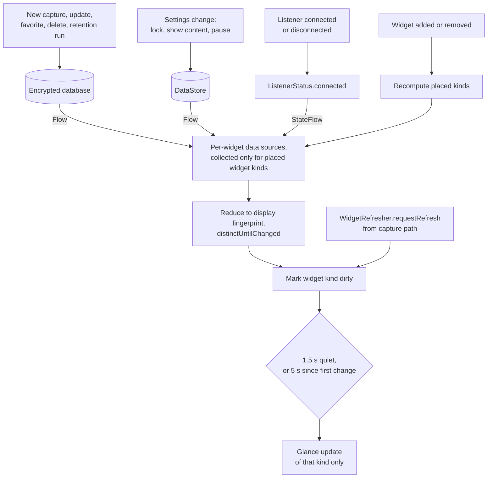

# UnsendVault widget design

Five home-screen widgets built with Jetpack Glance. They are privacy-first: by default they show **counts and app
names only**, never message text, senders or conversation titles. They refresh only when the archive or settings change; there is no periodic update and no
polling. The widget XML in `app/src/main/res/xml/widget_*_info.xml` and the code in `widget/` are authoritative for
exact dimensions.

## 1. The five widgets

There are three privacy modes (section 3): **Metadata** (default), **Content** (opt-in, app lock off) and **Locked**
(app lock on).

| Widget | Purpose | Metadata (default) | Content | Locked | Tap |
|---|---|---|---|---|---|
| **Archive count** | How much is archived | Total messages, conversations, apps | Same | Same numbers plus a lock hint | Opens the archive |
| **Recent** | Latest archived messages | Recent messages grouped by app: app label, count, relative time of the newest. No text, senders or conversation titles | Rows: app, conversation/sender, one-line truncated preview, relative time, newest first | One total count | Row opens that message (content mode) or the archive filtered to that app |
| **Favorites** | Starred messages | Favorites grouped by app, as Recent | Same row layout as Recent, favorites only | Favorites count | As Recent |
| **App summary** | Per-app breakdown | App labels with message and conversation counts and last activity | Same | Totals only (messages, apps) | Row opens the archive filtered to that app |
| **Capture control** | Is capture running? Pause/resume | State: Capturing, Paused, Access needed, Disconnected; one action | Same | Same | Pauses/resumes; in Access needed / Disconnected it opens the app's status screen (settings or rebind) |

The Capture control widget never shows message data, so it is the same in every privacy mode.

## 2. Sizes and responsive behavior

All widgets use `SizeMode.Responsive` with a small set of breakpoints, are resizable horizontally and vertically, and
set `updatePeriodMillis="0"`. Sizes below are the provider defaults (`targetCellWidth` x `targetCellHeight` on Android
12+, `minWidth` x `minHeight` before).

| Widget | Default | Minimum resize | Layout by size |
|---|---|---|---|
| Archive count | 2x2 (110x110 dp) | 110x40 dp | 1 row high: icon + total only. 2x2: total large, conversations and apps below. Wider: the three numbers side by side. |
| Recent | 4x2 (250x110 dp) | 110x110 dp | Narrow: count and "Open" only. Medium: 2-3 rows, title + time. Large (250x180+): up to about 6 rows with preview line. |
| Favorites | 4x2 (250x110 dp) | 110x110 dp | Same breakpoints as Recent. |
| App summary | 3x2 (180x110 dp) | 110x110 dp | Narrow: top 2 apps, counts only. Wider/taller: up to about 5 apps with conversation counts and last activity. |
| Capture control | 2x1 (110x40 dp) | 110x40 dp | 1 row: state dot + label + button. 2 rows: adds a short reason line ("Access was turned off"). |

Rules for every layout:

- Text never wraps into clipped half-lines: titles take one line with ellipsis; previews one line.
- Long names, emoji, right-to-left text and bidi control characters are handled: explicit bidi
  embeddings/overrides/isolates are stripped so they cannot reorder surrounding widget text.
- Empty state, access-needed state, locked state and a failure state ("Open UnsendVault", also used when the
  database cannot be read in time) all exist, plus a static error layout (`widget_error.xml`); a widget never renders
  blank.
- Lists are capped (no unbounded `LazyColumn` contents), so the RemoteViews payload stays small.

## 3. Privacy model

What a widget may reveal is decided in one pure function (`WidgetPrivacy`), unit-tested on the JVM:

1. **App lock enabled** -> `LOCKED`: counts plus a lock hint, regardless of any other setting. Message rows are not
   even loaded in this mode.
2. Otherwise, **Content** mode only when the user turned on **Show content in widgets** (`widgetShowContent`,
   default off). Turning on the app lock overrides it.
3. Otherwise **Metadata** mode: counts, app names and relative times only.
4. Messages whose `contentKind` is `SYSTEM_REDACTED` or `FILTERED_SENSITIVE` are never shown as text, even in Content
   mode; they appear as "Content hidden".
5. Widgets never show deletion-marker text or revision history.

Rationale: widgets are visible to anyone who can see the home screen and are not covered by `FLAG_SECURE`, so the
default must be safe for a phone left on a table.

## 4. Refresh model

- **No polling**: `updatePeriodMillis="0"` for every provider; no WorkManager periodic job and no alarms for widgets.
- **Only what is placed**: with no widget on the home screen, no data source is collected and the database is not
  opened on behalf of widgets.
- **Only what changed**: each source is reduced to a fingerprint of what the widget actually displays, so an unrelated
  database change (for example, a removal-reason update) does not re-render anything.
- **Debounced**: a burst of messages produces one render after about 1.5 s of quiet, and never more than about 5 s
  after the first change, so a constant stream cannot starve the widget.
- **Cheap to call**: `requestRefresh()` is non-suspending and lock-free, safe from the capture path.
- **Process death**: widgets keep their last RemoteViews. When the app process starts again (listener rebind, app
  open, widget tap, or a system `APPWIDGET_UPDATE` after reboot or launcher restart), the sync engine re-renders placed
  widgets once.

## 5. Accessibility

- Every interactive element has a content description that says what it does ("Pause capture", "Open message from
  Alex in WhatsApp"), not what it looks like.
- Numbers are announced with their meaning ("1,204 archived messages"), not as bare digits.
- Capture state is conveyed by text, not color alone (the colored dot is decorative).
- Touch targets are at least 48 dp; the capture button keeps 48 dp even in the 1-row layout.
- Text uses sp and is tested at the largest system font size; layouts drop secondary lines before clipping primary
  ones.
- Contrast: light and dark palettes meet WCAG AA for text; on Android 12+ dynamic colors are used through Glance's
  Material 3 color providers, with a static fallback below 12.

## 6. Launcher and OEM considerations

- **Cell sizes vary** by launcher and grid setting; the responsive breakpoints are in dp, not cells, and every
  breakpoint is usable at its minimum size.
- **Android 12+** uses `targetCellWidth`/`targetCellHeight`, rounded corners from the system
  (`system_app_widget_background_radius`), and `previewLayout`; older versions use `minWidth`/`minHeight` and the
  static preview image.
- **Some launchers** ignore `minResizeWidth` or allow sizes below the minimum; the smallest layout is the fallback for
  any size below the first breakpoint.
- **Some OEM launchers** delay or batch widget updates when the app is in the background or battery saver is on.
  Updates are idempotent (a later render always shows the current state), so a delayed update is late but never wrong.
- **Lock screen / keyguard widgets** are not supported (`widgetCategory="home_screen"` only), because content there
  would be visible without unlocking.
- **Work profile**: widgets in a work profile would talk to a separate app instance with its own (empty) archive;
  not a supported setup, but it does not leak data across profiles.

## 7. Testing

| What | How |
|---|---|
| Privacy decisions (locked, metadata, content, redacted rows) | JVM unit tests of `WidgetPrivacy` and the display models |
| Fingerprints and debounce timing (quiet period, max wait, placed-kinds filter) | JVM tests of the sync engine with a fake clock and `kotlinx-coroutines-test` |
| Composition at each responsive size, empty/locked/error states | `glance-appwidget-testing` unit tests |
| Tap actions (open message, open filtered archive, pause/resume) | Instrumented tests and manual check |
| Real launchers | Manual: Pixel Launcher (reference device), plus at least one OEM launcher when available; light/dark; largest font; RTL locale |
| No polling | Manual: with no data changes, `adb shell dumpsys appwidget` shows no new updates over an hour; with widgets removed, no widget data sources are active |
| Privacy end to end | Manual: enable app lock and confirm every widget falls back to counts; enable content with lock off; confirm OTP/redacted messages show "Content hidden" |
